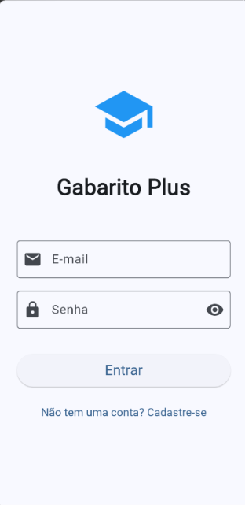
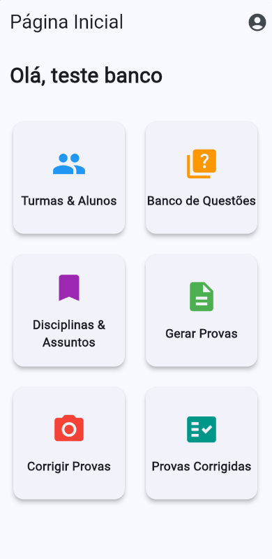
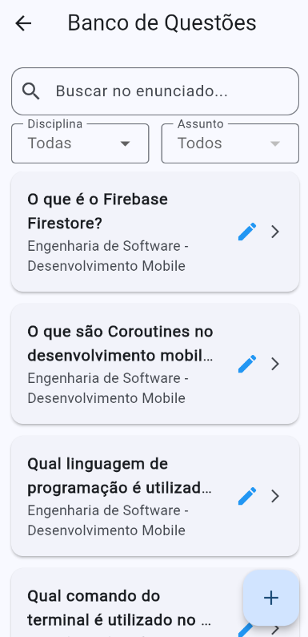
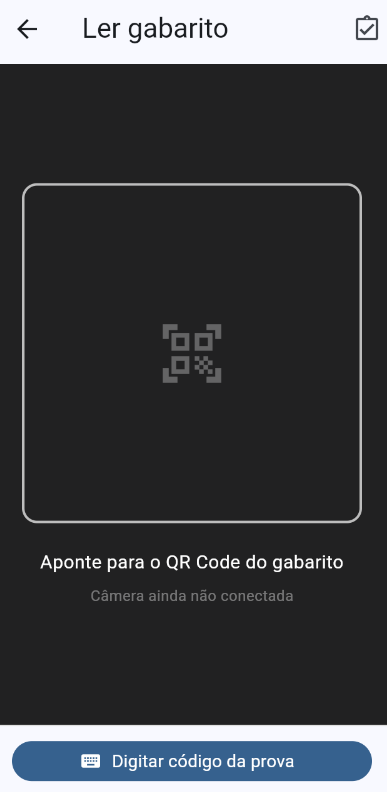

<div align="center">

# 🚀 Gabarito Plus

**Sistema móvel para geração e correção automatizada de provas utilizando visão computacional.**


</div>

## 👥 Equipe

| Nome completo |
|---|
| Enrique Zoz de Souza|
| Felipe Vieira |
| Natan Felipe Valente |
| Vicenzo Luiggi Mori |
| Esther Rigol de Souza |

## 📑 Sumário

- [1. Visão Geral](#1-visão-geral)
- [2. Requisitos](#2-requisitos)
  - [2.1 Funcionais (RF)](#21-funcionais-rf)
  - [2.2 Não Funcionais (RNF)](#22-não-funcionais-rnf)
- [3. Telas do Sistema](#3-telas-do-sistema)
- [4. Modelo de Dados](#4-modelo-de-dados)
- [5. Stack Tecnológica](#5-stack-tecnológica)
- [6. Estrutura de Pastas](#6-estrutura-de-pastas)
- [7. Como Executar o Projeto](#7-como-executar-o-projeto)
- [8. Backlog de Atividades da N2](#8-backlog-de-atividades-da-n2)

---

## 1. Visão Geral

📌 **N1 / N2**

O **Gabarito Plus** é uma plataforma educacional projetada para mitigar o tempo gasto por professores na criação, aplicação e correção de avaliações. O público-alvo são docentes e instituições de ensino que buscam agilidade no dia a dia. A solução permite que o professor gerencie seu próprio banco de questões, gere provas com alternativas embaralhadas de forma dinâmica e, como principal diferencial, realize a correção instantânea dos gabaritos dos alunos apenas apontando a câmera do celular através de visão computacional (QR Code/Leitura óptica).

## 2. Requisitos

📌 **N1 / N2**

### 2.1 Funcionais (RF)

| Código | Requisito |
|---|---|
| RF01 | O sistema deve permitir o cadastro e gerenciamento de perfis de professores. |
| RF02 | O sistema deve permitir o gerenciamento (CRUD) de turmas e alunos. |
| RF03 | O sistema deve permitir o cadastro e organização de disciplinas, assuntos e questões. |
| RF04 | O sistema deve gerar provas personalizadas com embaralhamento de questões e alternativas. |
| RF05 | O sistema deve permitir a leitura e correção automática de gabaritos utilizando a câmera (via QR Code/Visão Computacional). |
| RF06 | O sistema deve permitir a consulta do histórico de provas corrigidas e seus respectivos detalhes/notas. |

### 2.2 Não Funcionais (RNF)

| Código | Requisito |
|---|---|
| RNF01 | O aplicativo deve rodar perfeitamente em dispositivos móveis. |
| RNF02 | O sistema precisa solicitar e utilizar o acesso à câmera nativa do aparelho para as correções. |
| RNF03 | O armazenamento, consulta e persistência dos dados devem ser feitos em nuvem de forma escalável utilizando o ecossistema Firebase (Firestore/Auth). |

## 3. Telas do Sistema

📌 **N1 / N2**

*Tela inicial de autenticação do professor.*



*Painel principal com os módulos do sistema.*



*Listagem de questões cadastradas filtradas por assunto.*



*Interface de escaneamento de gabarito via câmera.*



## 4. Modelo de Dados

📌 **N3**

> *Atenção: A modelagem final dos documentos JSON das coleções do Firestore (ex: `professores`, `questoes`, `provas_corrigidas`) e o dicionário de dados detalhado serão incluídos e consolidados nesta seção durante a fase N3, conforme o escopo do projeto evolui do formato em memória (Mock) para o backend real.*

## 5. Stack Tecnológica

📌 **N1 / N2**


- **Flutter**: Framework de UI multiplataforma utilizado para construir toda a interface visual e a navegação responsiva do aplicativo.
- **Dart**: Linguagem de programação orientada a objetos que alimenta a lógica de negócio, controladores e serviços por trás do Flutter.
- **Firebase (Auth & Firestore)**: Plataforma de backend-as-a-service utilizada para gerenciar o banco de dados NoSQL em nuvem e a autenticação segura dos professores (Implementação foco da N2).

## 6. Estrutura de Pastas

📌 **N1 / N2**

O projeto adota uma **Clean Architecture (Feature-First)**, que agrupa os arquivos pelas funcionalidades reais de negócio em vez de seus tipos técnicos. Isso garante alta coesão e baixo acoplamento:

```text
lib/
  features/
    aluno/            # Módulo de alunos (cadastro, listagem)
    auth/             # Módulo de autenticação (login, cadastro)
    correcao_prova/   # Módulo de uso da câmera e leitura de respostas
    dashboard/        # Módulo de menu principal (hub de navegação)
    disciplina/       # Módulo para categorização (disciplinas e assuntos)
    geracao_prova/    # Módulo de configuração, embaralhamento e exportação
    professor/        # Domínio e gestão do perfil do professor
    questoes/         # Módulo do banco de questões (CRUD)
    turma/            # Módulo de organização de turmas
  widgets/            # Componentes visuais reaproveitáveis (ex: responsive_container.dart)
test/                 # Testes unitários (helpers, mocks de repository) e de integração (E2E)
```

Dentro de cada funcionalidade (`feature`), os arquivos são subdivididos logicamente em:
*   `data/`: Modelos de classes (`.dart`) e arquivos de dados estáticos/Mock para testes.
*   `service/`: Repositórios e regras de negócio para comunicação externa (ex: integração Firebase).
*   `ui/`: Telas e widgets específicos daquela funcionalidade.

## 7. Como Executar o Projeto

📌 **N1 / N2**

1. Clone o repositório na sua máquina:
   ```bash
   git clone https://github.com/FelipeVieira4/gabarito_plus.git
   ```
2. Acesse a pasta do projeto:
   ```bash
   cd gabarito_plus
   ```
3. Instale todas as dependências do Flutter:
   ```bash
   flutter pub get
   ```
4. *Observação N2:* Certifique-se de que os arquivos de configuração do Firebase (`google-services.json` para Android / `GoogleService-Info.plist` para iOS) e o arquivo `firebase_options.dart` estão configurados no projeto local, conforme as credenciais da equipe.
5. Conecte um dispositivo físico ou inicie o emulador e rode a aplicação:
   ```bash
   flutter run
   ```

## 8. Backlog de Atividades da N2

📌 **N2**

### Enrique Zoz de Souza

| Tarefa | Tempo (h) | Prazo | Status |
|---|---|---|---|
| Revisão e Estabilização dos Fluxos da N1 | 10 | 06/10/2026 | Concluído |
| Integração do Módulo de Autenticação com Firebase Auth | 12 | 10/10/2026 | Concluído |
| Atualização da Documentação e README da N2 | 6 | 28/10/2026 | Concluído |

### Felipe Vieira

| Tarefa | Tempo (h) | Prazo | Status |
|---|---|---|---|
| Configuração do Projeto Firebase e SDKs no Flutter | 8 | 08/10/2026 | Concluído |
| Migração de AlunoService e TurmaService para Firestore | 14 | 14/10/2026 | Concluído |
| Testes de Correção e Validação do Fluxo sem Mocks | 12 | 27/10/2026 | Concluído |

### Natan Felipe Valente

| Tarefa | Tempo (h) | Prazo | Status |
|---|---|---|---|
| Modelagem de Coleções no Cloud Firestore | 10 | 12/10/2026 | Concluído |
| Migração da Geração de Provas e Gabaritos para Firestore | 12 | 18/10/2026 | Concluído |
| Persistência Real dos Resultados de Correções no Firebase | 12 | 20/10/2026 | Concluído |

### Vicenzo Luiggi Mori

| Tarefa | Tempo (h) | Prazo | Status |
|---|---|---|---|
| Migração de QuestoesService e DisciplinasService para Firestore | 14 | 16/10/2026 | Concluído |
| Desenvolvimento da Tela de Consulta de Provas Corrigidas | 16 | 22/10/2026 | Concluído |
| Revisão Final, Testes de Regressão e Release da N2 | 8 | 29/10/2026 | Concluído |

### Esther Rigol de Souza

| Tarefa | Tempo (h) | Prazo | Status |
|---|---|---|---|
| Desenvolvimento da Tela de Detalhes da Prova Corrigida | 14 | 24/10/2026 | Concluído |
| Remoção Definitiva de Arquivos Mocks e Teste End-to-End | 8 | 25/10/2026 | Concluído |
